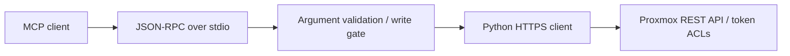

# Proxmox MCP Adapter

[](https://github.com/noaht360/proxmox-mcp/actions/workflows/checks.yml)

**A Python adapter for inspecting and managing Proxmox VE through an MCP client. Read-only by default.**

I started this adapter while working on my [Proxmox home lab](https://github.com/noaht360/proxmox-homelab). It connects an MCP client to the Proxmox REST API so node, guest, storage, and backup information can be inspected through tools. Optional administrative tools handle power actions, snapshots, and selected configuration changes.

## Quick start: offline demo

Requires **Python 3.10+**, with no third-party runtime or test dependencies. Run from the repository root:

```console
python examples/offline_demo.py
python -m unittest discover -s tests -v
```

The demo initializes the adapter, lists its read tools, reads three synthetic nodes, and rejects a shutdown attempt with writes disabled. It uses fixture HTTP responses, so you can try it without a server or credentials. See the [sample output](docs/demo-output.txt).

## Available tools

| Read tools | Optional administrative tools |
| --- | --- |
| Proxmox version and nodes | Start, shut down, or reboot a guest |
| VMs and containers across nodes | Create a guest snapshot |
| Datacenter and per-node storage | Update selected storage settings |
| Recent tasks and task logs | Create a scheduled backup job |
| Backup jobs | Refresh APT indexes |
| Guest status and snapshots | Add or enable/disable APT repository entries |
| Node APT repository configuration | |

The [tool catalog](docs/tool-catalog.md) lists names and required arguments. Write tools are hidden and blocked by default. To enable them, set `PROXMOX_ENABLE_WRITES=true` in the server environment and restart the MCP client. The API token’s Proxmox permissions still apply.

## Connect to Proxmox

1. Create a dedicated service user and API token with privilege separation. Grant both the permissions needed for the resources you want to inspect. See [permissions and security](docs/security.md).
2. Configure a trusted HTTPS certificate. For a private CA, set `PROXMOX_CA_FILE` to its PEM CA bundle.
3. On Windows, copy `env.example.ps1` to `env.local.ps1`, enter your local settings, and load them:

```powershell
. .\env.local.ps1
python .\proxmox_mcp_server.py --smoke-test
```

On Linux/macOS, export the equivalent environment variables. `.env.example` lists the settings; the adapter does not load dotenv files automatically.

The smoke test connects to the configured server and prints its version, nodes, and guest inventory. Treat the output as infrastructure information when sharing logs.

4. Configure your MCP client to launch `python /absolute/path/to/proxmox_mcp_server.py` as a **stdio** server and pass the environment variables to that process. The [client configuration example](examples/mcp-client.example.json) shows the launch structure; environment handling depends on the client.

## How it works



The adapter has three main parts:

- **Tool dispatch** defines the tools, validates arguments, and checks whether writes are enabled before constructing a client.
- **HTTP client** handles authentication, verified TLS, timeouts, redirect refusal, and response parsing. It separately blocks POST and PUT when writes are disabled.
- **Stdio handler** reads JSON-RPC messages and returns tool results or errors to the MCP client.

The implementation uses Python’s standard library to keep setup small. Guest and storage listings collect results across nodes and can retain successful results when an individual node request fails.

## Testing

The 22 automated tests cover request construction, write restrictions, argument validation, selected action payloads, error handling, and stdio behavior. GitHub Actions runs the tests, demo, and compilation checks on Python 3.10 and 3.12. See [testing and compatibility](docs/verification.md) for results and coverage.

## Compatibility and limits

The adapter implements the initialize-based stdio flow for MCP versions 2024-11-05, 2025-03-26, and 2025-06-18. It is a home-lab prototype with a focused tool set. This version has passed offline checks; live Proxmox testing remains pending.

- No HTTP server transport, OAuth, cancellation, automatic retries, rate limiting, or persistent audit store.
- The write flag enables all administrative tools together; there is no per-tool allowlist or approval UI. Use scoped Proxmox permissions and review actions in the client.
- Long-running operations can return a task ID. Check the task log for completion.
- Snapshots depend on the guest and storage configuration.

## Documentation

- [Tool catalog](docs/tool-catalog.md)
- [Permissions and security](docs/security.md)
- [Testing and compatibility](docs/verification.md)
- [Changelog](CHANGELOG.md)
