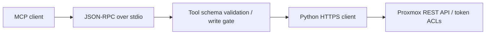

# Proxmox MCP Adapter

**A small Python adapter that lets an MCP client inspect a Proxmox home lab through its REST API. Read-only by default, with explicitly enabled administrative actions.**

Built from a helper used while documenting my [Proxmox lab](https://github.com/noaht360/proxmox-homelab). This public version adds write gating, input validation, verified HTTPS, offline tests, and a reproducible demo.

## Try it without a server

Requires **Python 3.10+**. No third-party runtime or test packages are required. From this repository's root:

```console
python examples/offline_demo.py
python -m unittest discover -s tests -v
```

The demo replaces the HTTP transport with a small fixture and exercises the real adapter dispatch and response parsing. It cannot contact or change a Proxmox server. [Recorded demo output](docs/demo-output.txt) is generated from that command, not from the live lab.

## What it does

| Default read tools | Optional write tools |
| --- | --- |
| Version and nodes | Guest start, shutdown, reboot |
| VMs and containers across nodes | Guest snapshot creation |
| Datacenter and per-node storage | Selected storage-setting updates |
| Recent cluster tasks and task logs | Scheduled backup-job creation |
| Backup-job inventory | APT index refresh |
| Guest runtime status and snapshots | Standard APT repository addition / enablement |
| Node APT-repository configuration | |

Write tools are omitted from discovery by default. Direct attempts to invoke them are rejected before constructing a client, and the HTTP client separately blocks POST and PUT. To enable them, set `PROXMOX_ENABLE_WRITES=true` **locally** and restart the MCP client. Proxmox's own ACLs still determine what the API token can do.

## Connect to your own lab

1. Create a dedicated Proxmox service user and API token with privilege separation. Grant only the read permissions needed at the intended scope to both user and token. See [permissions and security](docs/security.md).
2. Use a trusted HTTPS certificate, or point `PROXMOX_CA_FILE` at your private CA bundle. Certificate verification cannot be disabled in this public version.
3. On Windows, copy `env.example.ps1` to `env.local.ps1`, fill in local values, and load it:

```powershell
. .\env.local.ps1
python .\proxmox_mcp_server.py --smoke-test
```

On Linux/macOS, export the equivalent variables using your local secret-management workflow. `.env.example` is a reference; the server does not automatically load dotenv files.

The smoke test **does contact your configured server** and prints version, nodes, and guest inventory. Keep that output private unless sanitized.

4. Launch `python /absolute/path/to/proxmox_mcp_server.py` as a **stdio** server in an MCP client that passes the environment variables to the child process. Client configuration varies; see the [generic launch example](examples/mcp-client.example.json). No credentials belong in committed client configuration.

## Design



- Standard-library implementation keeps installation small and request construction inspectable.
- One HTTP request path centralizes authentication, timeouts, TLS, redirect refusal, and error handling.
- Tool arguments are checked before network access. Identifiers interpolated into node/storage paths reject slashes and query characters.
- Per-node guest/storage failures can be reported alongside other nodes' results.
- Mutations return the API result/task identifier; a returned task ID does not mean the operation has completed.

## Verification and limits

The automated suite covers request construction, default-denied writes, schema validation, selected action payloads, errors, and stdio behavior without network access. CI is configured for Python 3.10 and 3.12. Local results are recorded in [verification](docs/verification.md).

This is a **home-lab prototype**, not a full MCP SDK implementation. It uses the legacy initialize-based stdio flow for protocol versions 2024-11-05, 2025-03-26, and 2025-06-18. It has no HTTP transport, OAuth, pagination framework, cancellation, automatic retries, rate limiting, or application-level audit store. It is not certified against every Proxmox release or current MCP client. Live compatibility of this hardened public copy has not yet been tested.

The write flag enables the write catalog as a group. There is no per-tool allowlist or in-server approval UI; use a narrow API token and client-side review. Never expose this process as an unauthenticated network service.

## Project notes

- [Tool catalog](docs/tool-catalog.md)
- [Permissions and security decisions](docs/security.md)
- [Verification record](docs/verification.md)
- [Changes from the original helper](CHANGELOG.md)

Developed with AI assistance as part of my infrastructure portfolio. Recorded lab operations live in the companion repository; this repository's public demonstration uses synthetic data.
